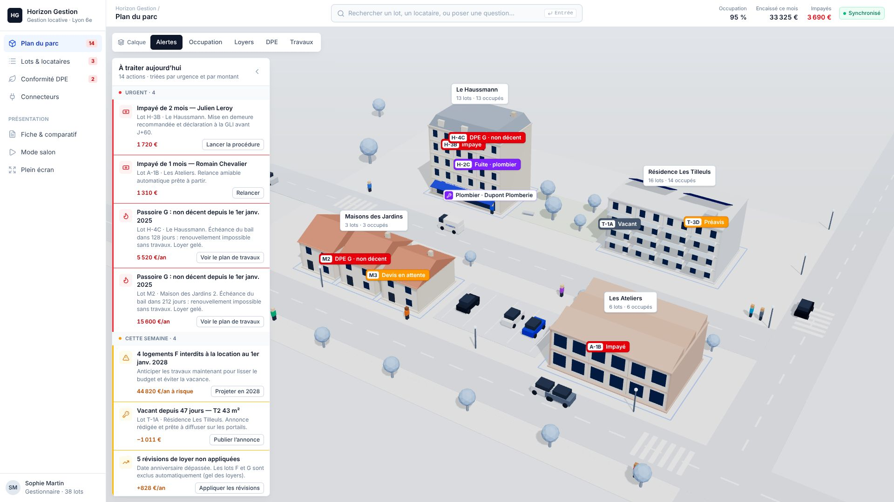
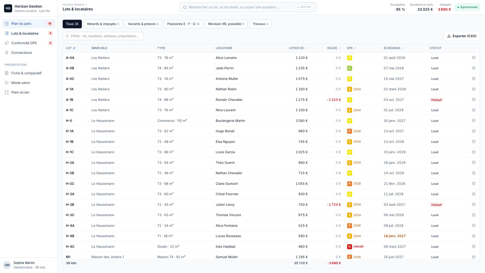
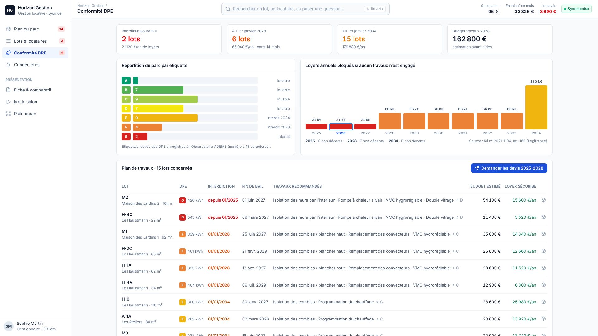
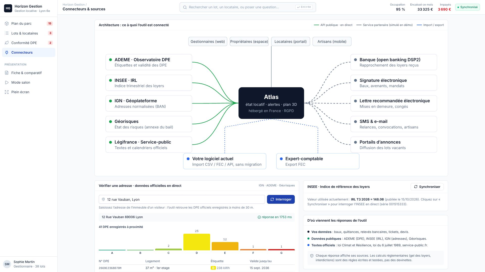

# Atlas · démo d'application métier sur mesure (gestion locative)

Démo de stand pour un club d'affaires. Elle montre ce qu'une **application métier sur mesure** apporte à un administrateur de biens, une agence ou un dirigeant qui détient des SCI :

- **Plan 3D du parc** : chaque lot est cliquable et coloré selon le calque choisi (alertes, occupation, loyers, DPE, travaux).
- **« À traiter aujourd'hui »** : impayés, passoires énergétiques, révisions IRL oubliées, fins de bail, devis en attente. Les actions sont triées par urgence et par montant, et chacune se règle en un clic.
- **Tableau des lots** : filtres, tri, actions groupées (relances, révisions IRL, demandes de devis) et export CSV.
- **Conformité DPE** : projection 2025 → 2034 des loyers bloqués et plan de travaux chiffré lot par lot.
- **Connecteurs** : schéma d'architecture et **appels en direct** aux API publiques ADEME (DPE), INSEE (IRL), IGN Géoplateforme (adresses) et Géorisques.
- **Fiche & comparatif** : fiche A4 recto verso, avec la comparaison sourcée face à un logiciel concurrent réel (Crypto, d'Orisha Real Estate).
- **Mode salon** : visite guidée en boucle quand personne ne touche l'écran.

## Aperçu

| Plan du parc | Lots & locataires |
|---|---|
|  |  |
| **Conformité DPE** | **Connecteurs (API publiques en direct)** |
|  |  |

## Lancer la démo

```bash
cd demo
npm install
npm run dev
```

Pour le stand (version compilée, sans dépendance réseau) :

```bash
cd demo
npm run build
npx vite preview --port 4173
```

Puis ouvrir `http://localhost:4173/?salon`. Raccourcis : **F** pour le plein écran, **S** pour le mode salon. Ajouter `?autosalon=0` à l'adresse pour désactiver le démarrage automatique.

Pour régénérer la fiche PDF après avoir modifié vos coordonnées (`MAKER` dans `demo/src/config.ts`), ouvrir `http://localhost:4173/?fiche` dans Chrome, puis Imprimer → Enregistrer en PDF (A4, marges : aucune, graphiques d'arrière-plan cochés).

## Contenu du dépôt

| Chemin | Contenu |
|---|---|
| `demo/` | Application (Vite, React, TypeScript, Three.js via React Three Fiber, Tailwind, Zustand) |
| `demo/src/config.ts` | Nom du client fictif, prénom, ville, valeur de l'IRL, délai du mode salon |
| `demo/src/data/portfolio.ts` | Parc fictif : 4 adresses, 38 lots, avec des situations scénarisées |
| `demo/src/data/insights.ts` | Moteur d'alertes et indicateurs |
| `demo/src/lib/utils.ts` | Règles réglementaires : calendrier DPE, gel des loyers F/G, IRL |
| `demo/src/lib/openData.ts` | Appels aux API publiques, avec repli hors ligne |
| `docs/SCRIPT-DEMO-SALON.md` | Déroulé du stand : accroches, démo en 3 min, objections, offre |
| `docs/AUDIT-SYNTHESE.md` | Synthèse de l'audit de marché (1 page) |
| `docs/audit/` | Audits détaillés et sourcés : marché (01), choix de la niche et prix (02), concurrent vérifié (03) |
| `docs/fiche-atlas.pdf` | Fiche A4 recto verso à imprimer |

## Limites assumées de la démo

Les données du parc sont fictives. Les questions en langage naturel passent par une reconnaissance de mots-clés hors ligne, pour que la démo fonctionne sans réseau. Les services partenaires (banque, signature, lettre recommandée électronique, SMS, portails) sont simulés. Les API publiques et les règles réglementaires, elles, sont réelles.
