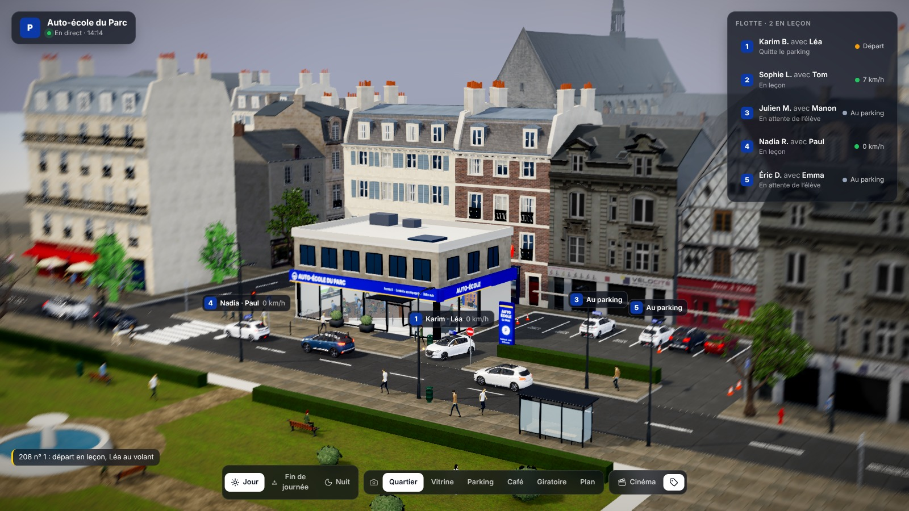
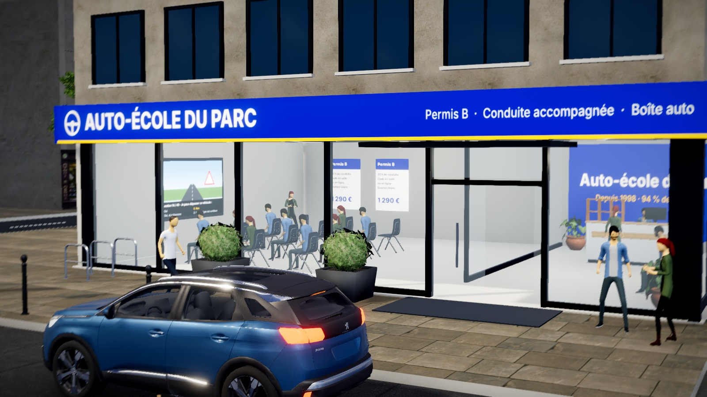
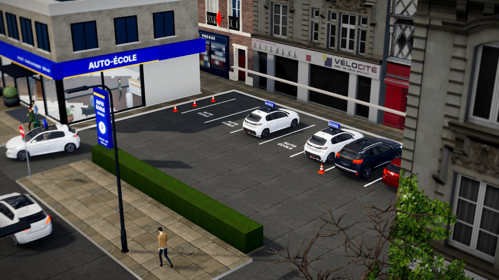
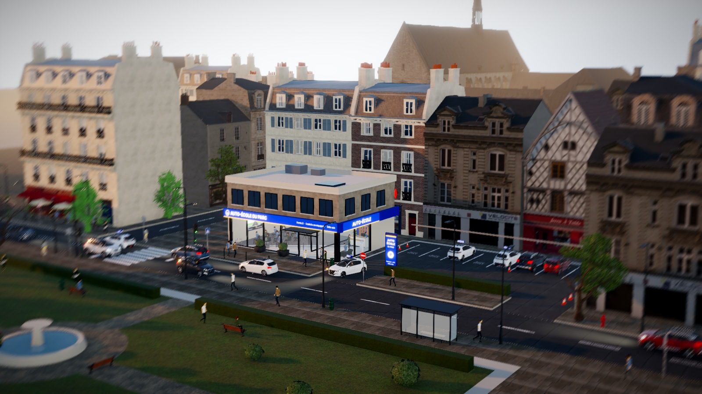
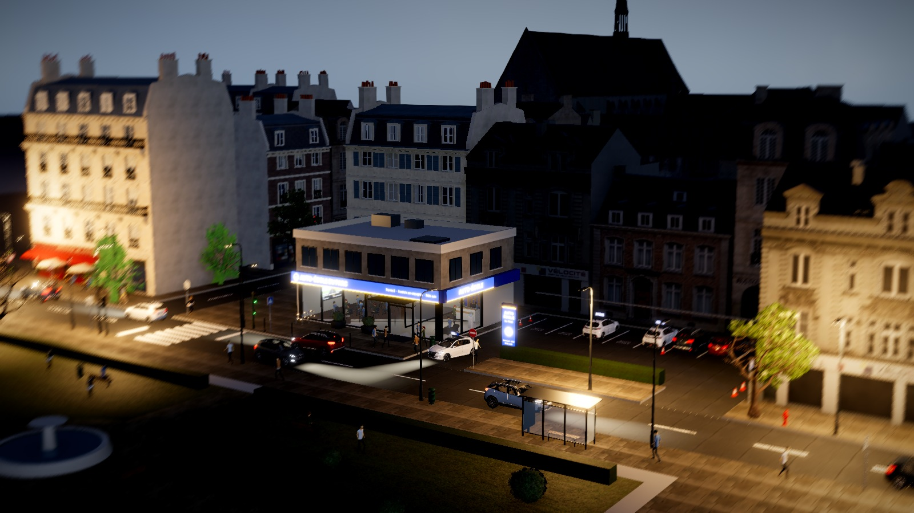
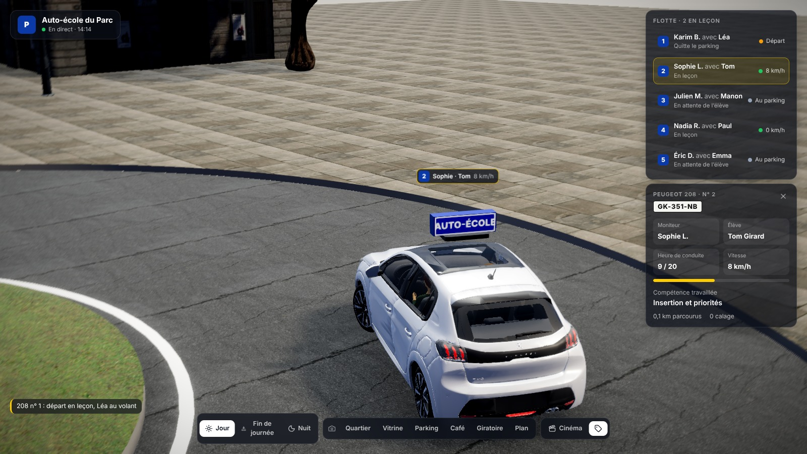

# Auto-école du Parc · diorama 3D en direct

Quartier de ville française à l'échelle réelle, autour d'une auto-école : cinq Peugeot 208 partent en leçon, circulent (giratoires, feux, passage piéton), reviennent se garer ; on voit la salle de code et l'accueil à travers la vitrine.

| Quartier | Vitrine | Parking |
|---|---|---|
|  |  |  |
| **Fin de journée** | **Nuit** | **Poursuite d'une voiture** |
|  |  |  |

## Lancer

```bash
npm install
npm run dev
```

## Repères

| Chemin | Rôle |
|---|---|
| `src/world.ts` | Plan du quartier en mètres, nom et couleurs de l'auto-école |
| `src/sim/` | Trajectoires, circulation, feux, piétons, cycle des leçons |
| `src/three/` | Décor, bâtiment de l'auto-école, voitures, personnages, lumière et effets |
| `src/ui/Hud.tsx` | Affichage : flotte, fiche d'une voiture, heure du jour, caméras |
| `public/models/` | Modèles 3D ; `index.json` est régénéré par `node scripts/index-models.mjs` |
| `scripts/shot.cjs` | Capture d'images fixes (`?still`) |
| `scripts/test-sim.ts` | Test de la simulation hors écran (blocages, collisions) |
| `CREDITS.md` | Crédits obligatoires des modèles CC-BY |

Paramètres d'URL utiles : `?tod=day|golden|night`, `?shot=hero|front|lot|cafe|roundabout|top|chase`, `?cinema`, `?q=low` (machines modestes), `?nohud`.
