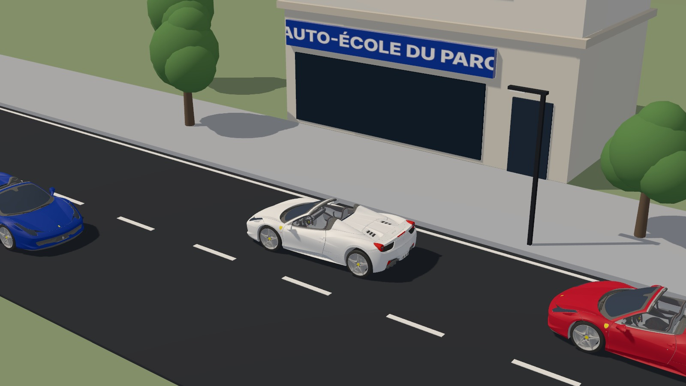
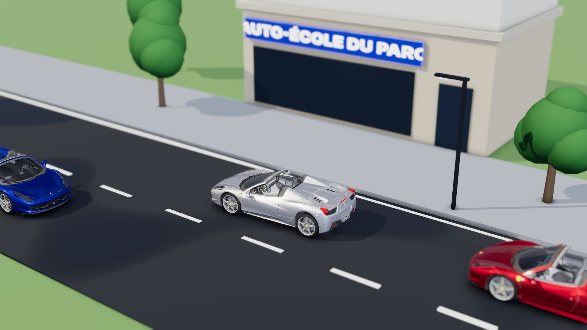
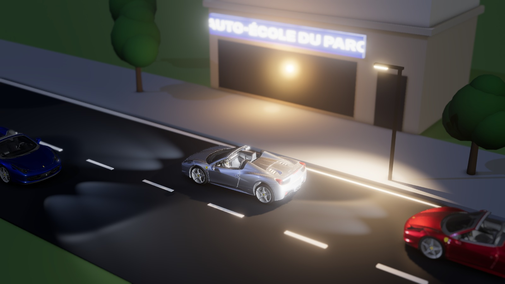

# Auto-école 3D : plan de production

> Objectif : un diorama web au rendu « jeu vidéo », partageable par lien, plus une vidéo de 30 s pour les réseaux. Recherche détaillée et sourcée : [`../audit/04-rendu-3d-etat-de-l-art.md`](../audit/04-rendu-3d-etat-de-l-art.md).

## 1. Le constat

| Ce qui fait le rendu | Poids | État actuel |
|---|---|---|
| Modèles 3D (voitures, bâtiments, personnages) | ~50 % | Des boîtes. C'est le vrai problème. |
| Lumière (HDRI, ombres douces, occlusion) | ~30 % | Une lampe, pas d'ambiance. |
| Post-traitement et shaders | ~20 % | Rien. |

Les pourcentages sont un jugement, pas une mesure. L'essai ci-dessous le montre : avec tous les effets, la voiture (vrai modèle) est crédible, le bâtiment (boîtes) reste pauvre.

| Sans effets | Jour | Nuit |
|---|---|---|
|  |  |  |

Essai réalisé ici avec Three.js r187 (code : `essai-rendu/essai.js`). La voiture est un modèle de test, pas le modèle final.

## 2. Décisions techniques

| Sujet | Décision | Raison |
|---|---|---|
| Moteur | **Three.js, pas Unity** | Lien qui s'ouvre partout en 2 s. Unity Web : runtime lourd, ~200 Mo de mémoire avant le premier asset, et je ne peux pas piloter son éditeur d'ici. |
| Blender | **Oui, piloté ici en ligne de commande** | Blender 5.3 tourne dans mon environnement (testé). Rien à installer de ton côté. |
| Moteur de rendu | **WebGL + bibliothèque de post-traitement pmndrs** | WebGPU est encore marqué expérimental et son API casse à chaque version. Ses atouts (illumination globale temps réel) sont inutiles si le décor est pré-calculé. |
| Décor | **Lumière pré-calculée dans Blender** (lightmaps, occlusion) | C'est ce qui donne le rendu « maquette » des jeux, sans coût en direct. |

## 3. Les techniques retenues, par impact

1. Éclairage HDRI (Poly Haven, libre) + tone mapping + exposition.
2. Lumière et occlusion pré-calculées dans Blender pour le décor.
3. Une ombre de soleil douce + ombre de contact sous chaque voiture.
4. Occlusion ambiante en espace écran (N8AO).
5. Carrosserie vernie (clearcoat), vitres, optiques émissives.
6. Effet maquette : profondeur de champ type tilt-shift.
7. Étalonnage couleur (LUT), vignette, grain léger.
8. Bloom sélectif : phares, feux stop, enseigne, fenêtres la nuit.
9. Cycle jour → heure dorée → nuit. Option : pluie et chaussée mouillée.
10. Arbres et herbe instanciés, animés par le vent (vertex shader).

## 4. Contenu de la scène

| Zone | Ce qu'on voit |
|---|---|
| Auto-école | Façade avec enseigne et logo, intérieur visible : accueil, salle de code avec élèves. |
| Parking | Flotte de 208 avec panneau de toit « AUTO-ÉCOLE » et livrée. |
| Rues | Rond-point, feux, passages piétons, zone de créneau, circulation. |
| Café d'en face | Moniteurs en pause, en terrasse. |

**Voitures** : trajectoires réalistes (roues qui tournent et braquent, clignotants, feux stop, arrêt au feu, créneau). Clic sur une voiture : moniteur, élève, heure n° 12/20, compétence travaillée, position sur le parcours.

**Moniteurs** : trois états visibles (en leçon, en pause au café, à l'accueil), avec le prochain rendez-vous.

**Caméra** : mode cinéma automatique (plans de drone, suivi d'une voiture), pensé pour la vidéo.

## 5. Étapes

| # | Étape | Livrable | Bloqué par |
|---|---|---|---|
| 1 | Modèles | 208 optimisée (~50 000 triangles, roues séparées), personnages, décor urbain | **Accès Sketchfab** |
| 2 | Diorama | Quartier modélisé, lumière pré-calculée | — |
| 3 | Rendu | Pile d'effets du § 3, jour et nuit | — |
| 4 | Vie | Voitures, moniteurs, élèves, feux | — |
| 5 | Interaction | Fiches au clic, HUD minimal, caméra cinéma | — |
| 6 | Diffusion | Lien en ligne + vidéo 30 s | Accord pour déployer |

À chaque étape, une version en ligne à juger sur ton écran.

## 6. Ce qu'il me faut

1. **Un compte Sketchfab gratuit et son jeton d'API** (Settings → Password & API). Les Peugeot 208 réalistes sous licence libre y sont, le téléchargement exige un compte. Je te demanderai le jeton par un formulaire sécurisé, jamais dans le chat.
2. **Ton accord pour déployer sur Vercel** un lien de prévisualisation à chaque étape.
3. Le nom et le logo de l'auto-école (fictive ou celle d'un prospect).

## 7. Limites à connaître

- **Je ne vois pas le rendu animé.** Mon environnement n'a pas de carte graphique : une image met une minute à calculer. Je valide sur images fixes, toi sur le lien.
- **Peugeot est une marque.** Modèle sous licence CC-BY : usage autorisé avec crédit de l'auteur. Pour une démo et un portfolio, le risque est faible. Ne pas laisser croire à un partenariat, et prévoir une voiture générique si la démo devient une publicité payante.
- **Modèles candidats** (Sketchfab, CC-BY) : « 2021 Peugeot 208 » (538 000 faces, à alléger), « Peugeot E-208 2020 » (1,2 M de faces), « Nouvelle Peugeot 208 - lowpoly » (2 440 faces, trop simple en gros plan). Qualité à vérifier une fois téléchargés.
- **Décor et personnages** : Kenney, KayKit et Quaternius (licence CC0). Leurs sites sont en partie bloqués depuis mon environnement : à débloquer ou à remplacer par Sketchfab.
- **L'auto-école est un bon sujet visuel, pas un bon acheteur** : petites structures, petits budgets. Cette démo vend ta capacité à faire ça pour n'importe quel métier, pas un logiciel d'auto-école.
